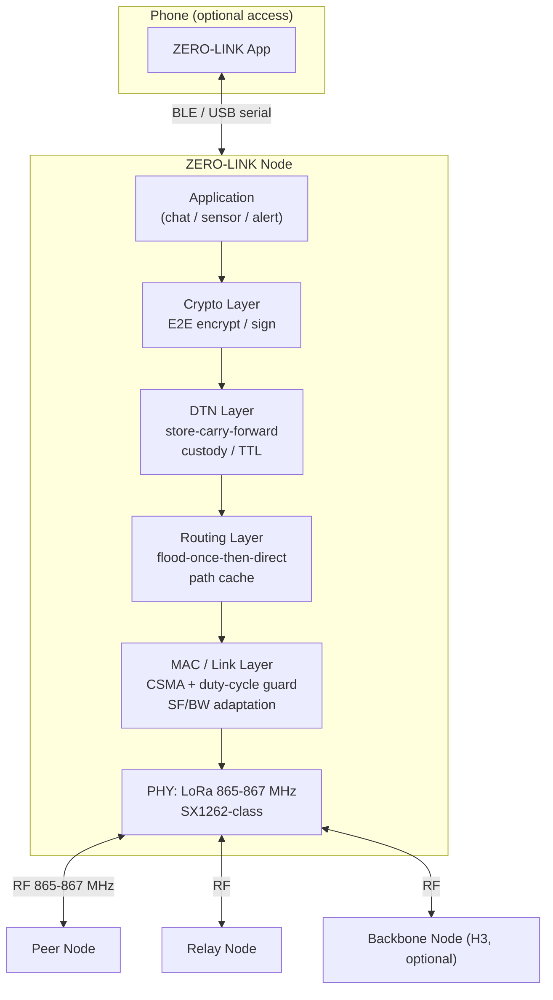
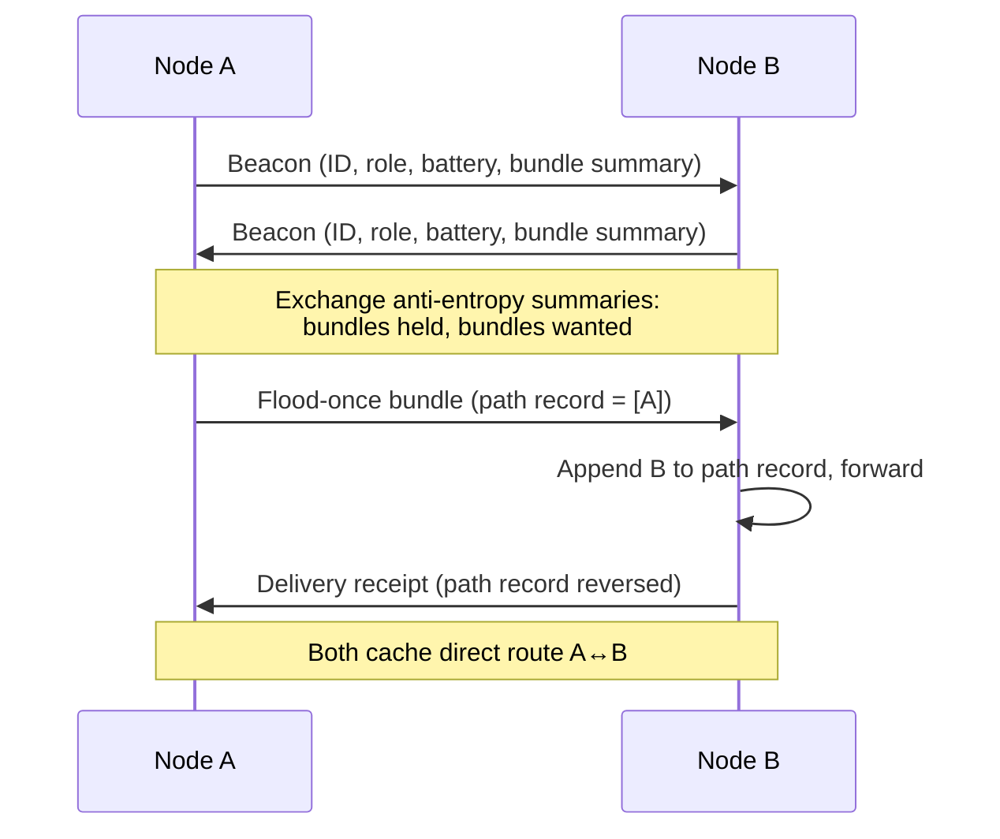

# ZERO-LINK — System Design

> **Architecture:** H1 TAM-DTN (Terrain-Adaptive LoRa Mesh with DTN Store-Carry-Forward) as primary, H3 backbone as optional upgrade, H2 ferrying as disconnected mode. See `ARCHITECTURE_HYPOTHESES.md`.
> **Layer separation:** Physical layer (LoRa PHY) is kept strictly separate from network architecture (routing/DTN/crypto). Either can be swapped without redesigning the other.

---

## 1. System overview

ZERO-LINK is a decentralised, infrastructure-independent messaging system for India. Nodes exchange E2E-encrypted bundles over sub-GHz LoRa links. When a connected multi-hop path exists, bundles route in seconds. When no path exists, bundles are stored and carried (DTN) until a contact appears. No servers, no gateways, no telecom infrastructure.

**Design goals (from mission):** No internet, no towers, no satellites, no central server, no operator dependence, secure delivery, practical path to 100 km, nationwide scalability potential. These are goals, not achieved claims.

---

## 2. System block diagram



---

## 3. Device architecture

### 3.1 Node types

| Type | Role | Hardware | Power |
|---|---|---|---|
| **Endpoint** | Send/receive messages; store-carry-forward | LoRa module + MCU + 2 dBi antenna + battery | Battery (days–weeks) |
| **Relay** | Forward others' bundles; same DTN logic | Endpoint + solar + mast (6–10 m) | Solar + battery |
| **Backbone** (H3) | Long-haul peer routing | Endpoint + solar + mast (10–30 m) + directional antenna (10–15 dBi) | Solar + battery |
| **Phone gateway** (optional) | UI for endpoints | Android phone + BLE | Phone battery |

All node types run the **same stack** (DTN + routing + crypto). Role is a configuration flag, not different firmware. This keeps the codebase single and the behaviour uniform.

### 3.2 Hardware reference (design target, not a purchase list)

- Radio: SX1262-class LoRa transceiver, 865–867 MHz, +20 dBm max conducted.
- MCU: ESP32-class (Wi-Fi/BLE for phone access; LoRa for mesh).
- Antenna: 2 dBi omni (endpoint/relay); 12 dBi directional (backbone).
- Power: 18650 Li-ion + 5–10 W solar (relay/backbone); USB/battery (endpoint).
- Storage: flash for bundle store (hundreds of bundles).

> No hardware has been purchased or tested. All performance figures are from link budgets and simulation, not measurements.

---

## 4. Communication layer (PHY/MAC)

- **PHY:** LoRa chirp spread-spectrum, 865–867 MHz. SF/BW per link:
  - Short (<2 km): SF7/BW125 (fast, ~5 kbps).
  - Medium (2–5 km): SF9/BW125.
  - Long (>5 km): SF12/BW125 (slow, ~250 bps, max range).
  - Adaptation: based on RSSI/SNR of recent beacons; hysteresis to avoid flapping.
- **MAC:** CSMA with listen-before-talk; randomised backoff; duty-cycle guard (self-imposed ≤1% airtime even if not legally required — good citizenship + battery).
- **MTU:** ≤242 B per LoRa frame; bundles >242 B are fragmented at DTN layer and reassembled at destination.

---

## 5. Discovery mechanism



- **Neighbour discovery:** Beacons every 30–120 s (adaptive: faster when mobile, slower when static).
- **Path discovery:** Flood-once with accumulating path record (MeshCore pattern). Destination returns the path; both ends cache it with expiry.
- **Anti-entropy:** On contact, nodes exchange bundle summaries and pull missing bundles (DTN sync).

---

## 6. Addressing mechanism

- **Node ID:** 128-bit random ID + Ed25519 public key (identity). Short display name (optional, user-chosen).
- **Bundle address:** Destination Node ID (or group ID for broadcast).
- **No IP addresses, no DNS, no servers.** Identity is the address. Key exchange is in-person (QR code / BLE) for trust establishment, or opportunistic with TOFU (trust-on-first-use) + out-of-band verification.

---

## 7. Routing architecture

Two modes, selected per bundle:

| Mode | When | How |
|---|---|---|
| **Connected (flood-once-then-direct)** | Path likely exists (recent contact with destination or via relays) | First bundle floods; path cached; later bundles use direct source route |
| **DTN (store-carry-forward)** | No path (partition) | Store bundle; forward opportunistically on contact with copy budget (max 4–8 copies); custody transfer per hop |

**Pseudocode — forwarding decision:**

```
on_bundle_ready(bundle):
    if route_cache.has_fresh_route(bundle.dest):
        send_via_route(bundle, route_cache.get(bundle.dest))
    elif neighbour_has_bundle(bundle.dest) or is_mobile():
        store_and_forward(bundle)   # DTN: keep copy, forward on contact
    else:
        flood_once(bundle)          # discover path
        store_and_forward(bundle)   # keep copy until receipt

on_contact(neighbour):
    exchange_summaries(neighbour)
    for bundle in store:
        if neighbour.wants(bundle) and bundle.copies < MAX_COPIES:
            forward(bundle, neighbour)
            bundle.copies += 1
    if neighbour.has_bundle_for_me():
        pull_missing_bundles(neighbour)

on_receipt(bundle_id, path_record):
    delete_stored_bundle(bundle_id)
    cache_route(path_record)
```

---

## 8. Message delivery mechanism

- **Custody transfer:** Each forwarder ACKs custody to the previous hop. Sender keeps its copy until custody ACK.
- **E2E receipt:** Destination sends a signed delivery receipt back (via cached route or DTN). Sender deletes its copy only on E2E receipt (or TTL expiry).
- **TTL/expiry:** Bundles expire after 24–72 h (configurable). Expired bundles are deleted and sender is notified if possible.
- **Duplicate suppression:** Bundle ID (UUID) + seen-cache at each node.

---

## 9. Encryption architecture

- **Identity:** Ed25519 keypair per node. Public key = identity.
- **Key exchange:** X25519 ECDH (in-person QR/BLE for trusted contacts; TOFU otherwise).
- **Session:** HKDF-derived AES-256-GCM keys; forward secrecy via ratcheting (Double-Ratchet-inspired, simplified for low rate).
- **Signing:** Ed25519 signatures on receipts and path records (prevents route forgery).
- **Replay protection:** Per-bundle nonce + timestamp + seen-cache; receipts include bundle ID hash.
- **Metadata:** Routing headers in clear (needed for forwarding); payload ciphertext only. Optional padding to fixed size to reduce traffic analysis (costs airtime — off by default).
- **Compromise:** No central server to breach; node compromise exposes only that node's keys/bundles. Revocation via signed revocation messages gossiped through the mesh.

---

## 10. Error detection and recovery

| Layer | Mechanism |
|---|---|
| PHY | LoRa CRC + FEC (coding rate 4/5–4/8) |
| Link | Hop-by-hop custody ACK; retransmit on timeout |
| DTN | Bundle checksum (SHA-256 truncated); reassembly with fragment ACKs |
| E2E | AES-GCM authentication tag; signed delivery receipt |

---

## 11. Offline operation model

- **Fully offline:** All functions (messaging, routing, crypto) work without internet.
- **Phone access:** Optional BLE/USB link to Android app for UI. Node works standalone without phone.
- **No accounts, no servers, no phone numbers.** Identity = keypair.

---

## 12. Scalability strategy

- **Flooding bound:** Flood-once-then-direct limits flood cost to first contact per destination.
- **Copy bound:** DTN max copies (4–8) bounds epidemic storage/energy.
- **Role separation:** Endpoints do not relay by default (relay flag); reduces airtime waste.
- **Channel plan:** Multiple LoRa channels (865.0625 / 865.4025 / 865.985 MHz [R8]) + SF diversity; backbone on separate channel from access.
- **Nationwide vision:** Scale by adding relays/backbone nodes (peer-operated), not by adding servers. Each new area needs its own relay density — nationwide coverage is a deployment programme, not a software feature.

---

## 13. Failure handling

| Failure | Handling |
|---|---|
| Relay down | Route cache expires; DTN stores bundles; alternative path discovered on next flood |
| Node battery low | Shed relay duty (relay flag off); prioritise own bundles |
| Partition | DTN store-carry-forward; delivery on reconnection (minutes–days) |
| Bundle TTL expiry | Delete; notify sender if path exists |
| Key compromise | Signed revocation gossiped; contacts re-key |
| Channel congestion | Backoff + SF adaptation + copy-budget reduction |

---

## 14. What this design does NOT claim

- No single-hop 100 km (see `FEASIBILITY_100KM.md`).
- No guaranteed latency (DTN latency is unbounded without mobility/relay guarantees).
- No novelty over Reticulum at the stack level (see `ARCHITECTURE_HYPOTHESES.md`).
- No hardware-validated performance (simulation only, see `SIMULATION_PLAN.md`).
